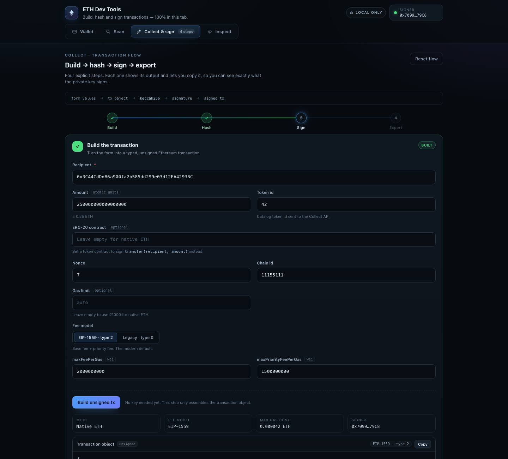
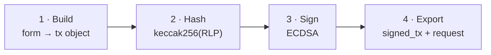
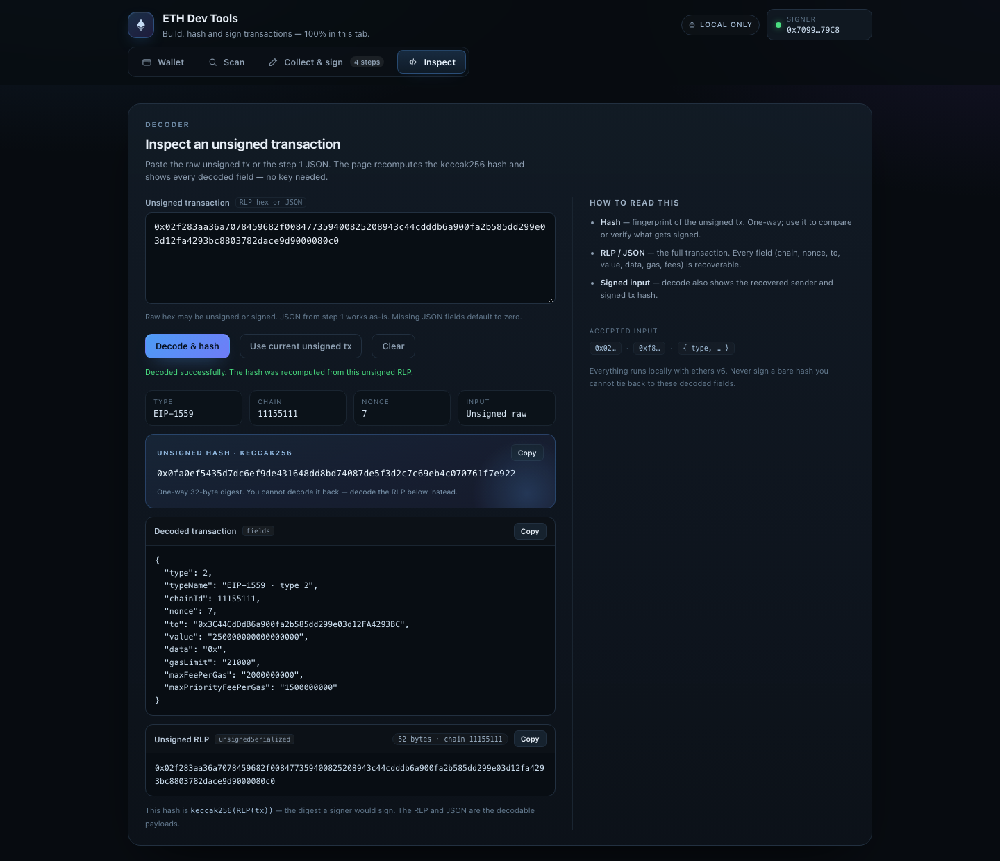

<p align="center">
  
</p>

<h1 align="center">ETH Dev Tools</h1>

<p align="center">
  A local-first Ethereum workbench for scanner testing.<br />
  Build, hash, sign and inspect transactions without a node, a backend, or a wallet extension.
</p>

<p align="center">
  <a href="https://afsh7n.github.io/dev-tools-eth/"></a>
  
  
  
</p>

<p align="center">
  <a href="https://afsh7n.github.io/dev-tools-eth/">Live app</a> ·
  <a href="#collect-flow">Collect flow</a> ·
  <a href="#inspect">Inspect</a> ·
  <a href="#fields">Fields</a> ·
  <a href="#quick-start">Quick start</a>
</p>

---

**ETH Dev Tools** is a single `index.html` for day-to-day Ethereum scanner work: create a throwaway address, build the watch-list payload, and turn a Collect request into a verified signed transaction. It also decodes raw transactions so you can see exactly what a hash and signature cover.

The private key never leaves the tab. Address generation, hashing and signing run locally with `ethers` v6 from a CDN. The page does not talk to a node and cannot speak native gRPC, so Scan and Collect produce the JSON bodies you paste into Postman or grpcurl. No auth metadata is attached — add whatever your gRPC client requires.

## What it does

| Tab | Job |
| --- | --- |
| **Wallet** | Generate an Ethereum keypair (`0x…`), reveal or copy the key, download `wallet.json`, or load one. |
| **Scan** | Build the `BatchUpdateAddresses` body for `ethereum_scanner.AddressService` with operation `ADDRESS_OPERATION_ADD`. |
| **Collect & sign** | Four explicit steps: build the unsigned tx, compute its hash, sign it, export the Collect item. Each step exposes its output and a copy button. |
| **Inspect** | Paste unsigned RLP, the step 1 JSON, or a signed raw transaction. Get the keccak256 hash and a decoded view of every field. |

## Collect flow



- **Build** assembles a typed transaction object. No key is required yet.
- **Hash** shows the 32-byte unsigned hash plus the canonical RLP bytes that were hashed.
- **Sign** attaches the signature to that exact payload. Success is reported only after the recovered signer matches the loaded wallet and the unsigned hash still matches step 2.
- **Export** produces the final item and the full `{ "items": [ item ] }` CollectRequest. Both can be copied or downloaded.

Changing any Collect input clears the derived hash, signature and exports, so a stale payload cannot be sent by accident. Reset the flow at any time without losing the form values.

## Inspect

<p align="center">
  
</p>

The Inspect tab accepts:

- the **unsigned RLP** produced in step 2,
- the **transaction JSON** produced in step 1,
- or a **signed raw transaction** — unsigned hash, recovered sender, signed hash and signature parts are all shown.

Decoded output includes type, chain id, nonce, to, value, calldata, gas limit and fee fields. ERC-20 `transfer` calldata gets a readable recipient/amount callout. **Use current unsigned tx** pulls the current Collect payload directly from the other tab.

## Hash vs. payload

| Artifact | What it is | Decodable? | Use it for |
| --- | --- | --- | --- |
| Unsigned hash | 32-byte `keccak256(RLP(tx))` digest | No | Comparing or verifying what gets signed |
| Unsigned RLP | Full transaction fields, no signature | Yes | Inspecting, auditing, external signers |
| `signed_tx` | Full transaction plus signature | Yes | Sending to Collect / broadcasting |
| Signed tx hash | Hash of the signed transaction bytes | No | Tracking the broadcast transaction |

The hash is a one-way fingerprint. If you need the fields, decode the RLP or the JSON — never try to read them from the hash.

## Rules

An empty ERC-20 contract field signs native ETH. A contract address signs an ERC-20 `transfer`. `amount` is an atomic-unit integer (wei for ETH).

Leave `gasPrice` empty to sign an EIP-1559 type-2 transaction. Set `gasPrice` to sign a legacy type-0 transaction instead.

`signed_tx` is the raw signed transaction hex — the payload the scanner parses and later broadcasts.

## Fields

| Field | Role |
| --- | --- |
| `to_address` | Recipient. `0x` address. |
| `amount` | Atomic units. |
| `nonce` | Sender nonce. Integer `>= 0`. Default `0`. |
| `token_id` | Catalog token id. |
| ERC-20 contract | Empty means native ETH. |
| `chainId` | Chain id. Default `1`. |
| `gasLimit` | Empty means `21000` for ETH and `65000` for ERC-20. |
| Fee model | EIP-1559 by default; switch to legacy to use `gasPrice`. |
| `maxFeePerGas` | Wei. EIP-1559. Default `1000000000`. |
| `maxPriorityFeePerGas` | Wei. EIP-1559. Default `1000000000`. |
| `gasPrice` | Wei. Set this to sign a legacy type-0 transaction instead. |

Final Collect item:

```json
{
  "from_address": "0x…",
  "to_address": "0x…",
  "token_id": "1",
  "amount": "1000000000000000000",
  "nonce": 0,
  "signed_tx": "0x02f8…"
}
```

## Quick start

Use the [live page](https://afsh7n.github.io/dev-tools-eth/), or run it locally:

```bash
git clone https://github.com/afsh7n/dev-tools-eth.git
cd dev-tools-eth
python3 -m http.server 8765
# open http://localhost:8765
```

Opening `index.html` directly also works. An internet connection is needed the first time to load ethers from the CDN.

## Safety

- Use throwaway development keys only. Never use a production wallet.
- The private key lives in memory for the lifetime of the tab and is never uploaded, logged or stored.
- Downloading `wallet.json` writes the key to disk in plain text. Keep it out of git.
- Every signature is locally verified before it is presented as successful. Check the decoded fields and hash before signing anything.

## Project layout

```text
dev-tools-eth/
├── index.html   # the entire app: UI, styling and transaction logic
├── assets/      # README screenshots
└── README.md
```

Built with vanilla HTML/CSS/JS and [ethers v6](https://docs.ethers.org/v6/). No framework, no bundler, no backend.
